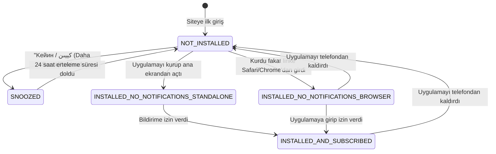

# Ötüken Web — PWA Yaşam Döngüsü, Kurulum ve Bildirim Durum Rehberi

Bu belge, Ötüken Web uygulamasının mobil ve masaüstü cihazlarda **Ana Ekrana Ekleme (PWA Kurulumu)**, **Bildirim İzin Durumu**, **Uygulama Kaldırma (Uninstallation) Algılama** ve **Akıllı Hatırlatma (24 Saat Erteleme)** mantığını detaylandırmaktadır.

---

## 1. Tarayıcı ve İşletim Sistemi Algılama Yetenekleri

Uygulamanın kullanıcının cihazındaki durumunu nasıl bildiğinin teknik detayları:

| Durum | Algılama Yöntemi / API | Platform Desteği | Güvenilirlik |
| :--- | :--- | :--- | :--- |
| **Ana Ekrana Eklendi mi? (Standalone)** | `window.matchMedia('(display-mode: standalone)').matches` | Android, iOS Safari, macOS, Windows | **%100 Kesin** |
| **iOS WebClip İçi Çalışma** | `window.navigator.standalone === true` | Yalnızca iOS Safari | **%100 Kesin** |
| **Android / Chrome Kurulum Anı** | `window.addEventListener('appinstalled')` | Chromium tabanlı tarayıcılar (Android, Edge, Chrome) | **%100 Anlık** |
| **Yüklü Web Uygulamalarını Sorgulama** | `navigator.getInstalledRelatedApps()` | Android Chrome 80+, Desktop Chrome | **%100 İşletim Sistemi Seviyesi** |
| **Bildirim İzni Verildi mi?** | `Notification.permission` (`'granted'`, `'denied'`, `'default'`) | Tüm modern tarayıcılar & iOS PWA | **%100 Anlık** |
| **iOS Web Push Özel Durumu** | iOS WebKit'te Web Push bildirimleri **yalnızca ana ekrana eklenmiş PWA'larda** çalışabilir. iOS'ta bildirim izni verilmişse, uygulamanın kesinlikle ana ekranda kurulu olduğu kesinleşmiş olur. | iOS 16.4+ | **%100 Kesin** |

---

## 2. Kullanıcı Yaşam Döngüsü Durum Makinesi (State Machine)

Tüm kullanıcı etkileşimleri deterministik bir durum makinesiyle [`src/lib/pwa-utils.ts`](file:///Users/muhammedemin/Documents/Bashqilar/Project_Otuken/Otuken_New_Web/src/lib/pwa-utils.ts) üzerinde yönetilir:



---

## 3. Senaryolar ve Alınan Aksiyonlar

### Senaryo 1: Kullanıcı Uygulamayı Henüz Yüklemediyse
* **Durum Kodu:** `NOT_INSTALLED`
* **Görünen Mesaj:** Klasik kurulum teklifi banner'ı (`PwaInstallToast`):
  * **Uygurca:** *«ئۆتۈكەن ئەپىنى قاچىلاڭ»*
  * **Kiril:** *«Өтүкән Әпини Қачилаң»*
* **Aksiyonlar:**
  * **Android / Chrome:** Doğrudan sistem kurulum penceresini açan **«قاچىلاش (Yükle)»** butonu.
  * **iOS Safari:** Paylaş simgesi ve *"Ana Ekrana Ekle"* adımlarını gösteren rehber butonu.
  * **Erteleme Butonu:** **«كېيىن / Кейин (Daha Sonra)»**.

### Senaryo 2: Kullanıcı "Daha Sonra" (كېيىن) Dediyse
* **Durum Kodu:** `SNOOZED`
* **Çalışma Prensibi:**
  * Kullanıcı banner'ı kapattığında o anın zaman damgası `localStorage`'a kaydedilir (`otuken_pwa_toast_dismissed`).
  * **24 saat boyunca** kullanıcı siteyi kaç defa açarsa açsın hiçbir teklif çıkarılmaz (rahatsız etmeme kuralı).
  * **24 saat dolduktan sonra** kullanıcı siteye tekrar girdiğinde banner nezaketle yeniden görünür.

### Senaryo 3: Uygulamayı Yükledi Ama Bildirimleri Açmadıysa
Kullanıcının o an nereden girdiğine göre iki farklı akıllı davranış sergilenir:

#### A. Tarayıcıda Geziyorsa (Safari veya Chrome üzerinden girdi):
* **Durum Kodu:** `INSTALLED_NO_NOTIFICATIONS_BROWSER`
* **Görünen Mesaj:** "Uygulamayı yükleyin" denmez; bildirimleri açması hatırlatılır:
  * **Uygurca:** *«ئۆتۈكەن ئەپىنى قاچىلىغانسىز، ئەمما ئۇقتۇرۇش قوزغىتىلمىغان. يېڭى يازمىلاردىن خەۋەردار بولۇش ئۈچۈن باش ئېكراندىكى ئەپكە كىرىپ ئۇقتۇرۇشنى ئېچىڭ.»*
  * **Kiril:** *«Өтүкән әпини қачилиғансиз, амма уқтуруш қозғитилмиған. Йеңи язмиلارдин хәвәрдар болуش үчүн баш экрандики әпкә кирип уқтурушни ечиң.»*
* **Aksiyon:** Kullanıcı **«چۈشەندىم / Чүشәндим (Anladım)»** butonuna basarak bildirimi kapatabilir.

#### B. Kurulmuş Uygulamanın İçindeyse (Ana ekrandan açtıysa):
* **Durum Kodu:** `INSTALLED_NO_NOTIFICATIONS_STANDALONE`
* **Görünen Mesaj:** Kurulum toast'ı asla çıkmaz. Ekranın sağ alt köşesinde doğrudan izin isteyen bildirim butonu belirir:
  * *«يېڭى يازما ئۇقتۇرۇشىنى قوزغىتىش»*
* **Aksiyon:** Kullanıcı tek tıkla `Notification.requestPermission()` sistem penceresini açıp bildirimleri onaylayabilir.

### Senaryo 4: Yükledi ve Bildirime Onay Verdiyse
* **Durum Kodu:** `INSTALLED_AND_SUBSCRIBED`
* **Alınan Aksiyon:** **HİÇBİR MESAJ VEYA BANNER ÇIKMAZ.**
* Ekran %100 temiz ve kesintisizdir. Kullanıcı makalelerine doğrudan odaklanır.

### Senaryo 5: Yükleyip Daha Sonra Kaldırdıysa (Uninstallation)
Uygulamanın telefondan silindiği şu mekanizmalarla tespit edilir:
1. **Android / Chromium:** Bir PWA kaldırıldığında tarayıcı bunu anında anlar ve sonraki ziyarette `beforeinstallprompt` olayını yeniden fırlatır. Ayrıca `navigator.getInstalledRelatedApps()` fonksiyonu boş dizi (`[]`) döner. Kod bu anı yakaladığı an `otuken_pwa_installed` kaydını temizler.
2. **iOS Safari:** Safari ayrı bir alanda çalıştığı için, kullanıcı 14 gün boyunca ana ekrandaki uygulamayı açmamışsa (`otuken_pwa_last_standalone`), uygulamanın kaldırılmış veya iptal edilmiş olabileceği varsayılır ve durum otomatik olarak `NOT_INSTALLED` haline döner.
* **Sonuç:** Kullanıcı bir sonraki ziyaretinde tekrar **Senaryo 1**'deki gibi *"Ötüken Uygulamasını Yükleyin"* teklifini görür.

---

## 4. İlgili Kod Dosyaları ve Görevleri

| Dosya Yolu | Rolü ve İşlevi |
| :--- | :--- |
| [`src/lib/pwa-utils.ts`](file:///Users/muhammedemin/Documents/Bashqilar/Project_Otuken/Otuken_New_Web/src/lib/pwa-utils.ts) | Durum makinesinin çekirdeği (`determinePwaUserState`, `shouldShowInstallToast`, `syncRealAppInstallationState`). |
| [`src/components/pwa-install-toast.tsx`](file:///Users/muhammedemin/Documents/Bashqilar/Project_Otuken/Otuken_New_Web/src/components/pwa-install-toast.tsx) | Alt bildirim banner'ı. Duruma göre kurulum veya bildirim açma metinlerini render eder. |
| [`src/components/pwa-provider.tsx`](file:///Users/muhammedemin/Documents/Bashqilar/Project_Otuken/Otuken_New_Web/src/components/pwa-provider.tsx) | Service Worker kaydı, standalone zaman damgası takibi, foreground bildirim toast'ı ve izin istemcisi. |
| [`src/app/manifest.ts`](file:///Users/muhammedemin/Documents/Bashqilar/Project_Otuken/Otuken_New_Web/src/app/manifest.ts) | Web App Manifest ve `related_applications` tanımları. |
| [`tests/pwa.test.ts`](file:///Users/muhammedemin/Documents/Bashqilar/Project_Otuken/Otuken_New_Web/tests/pwa.test.ts) | Tüm yaşam döngüsü senaryolarını doğrulayan otomatik birim testleri. |

---

## 5. Doğrulama ve Otomatik Testler

Sistem mantığı Node.js test koşucusu ile test edilmektedir:

```bash
npm test
```

### Test Çıktısı:
```text
✔ shouldShowInstallToast: correctly enforces snooze, standalone, and installed notification state
✔ determinePwaUserState: handles all 5 lifecycle states and uninstallation recovery
ℹ tests 19 | pass 19 | fail 0
```

---

## 6. iPhone'da Chrome mu Safari mi? (Tarayıcı Uyumluluk Rehberi)

### Sık Sorulan Soru: *"iPhone'da Chrome ile çalışabilir miyiz, yoksa Safari zorunlu mu?"*

### 🟢 Kısa Cevap:
**Evet, iPhone'da Google Chrome ile de çalışabilirsiniz; Safari zorunlu DEĞİLDİR.**
Ancak Apple'ın iOS işletim sistemi seviyesindeki güvenlik ve WebKit kurallarını bilmek gerekir:

### 1. iOS'taki Tüm Tarayıcılar Aslında WebKit'tir
Apple'ın App Store kuralları gereği, iPhone'daki Google Chrome Google'ın Blink motorunu çalıştıramaz; Apple'ın **WebKit (Safari motoru)** altyapısını kullanmak zorundadır. Dolayısıyla Chrome ve Safari aynı çekirdeği paylaşır.

### 2. Chrome ile Ana Ekrana Ekleme (iOS 16.4+)
* **iOS 16.4 Öncesi:** Apple sadece Safari'ye izin veriyordu.
* **iOS 16.4 ve Sonrası (Güncel):** Apple, Google Chrome ve Firefox gibi üçüncü taraf tarayıcılara da *"Ana Ekrana Ekle (Add to Home Screen)"* yetkisi verdi.
* **Chrome Adımları:**
  1. iPhone'da Chrome açılır.
  2. Adres çubuğundaki **Paylaş (Share)** simgesine (veya 3 noktaya) basılır.
  3. Aşağı kaydırıp **«Ana Ekrana Ekle» (Add to Home Screen)** seçilir.
  4. Simge ana ekrana eklenir.

### 3. Bildirimler (Web Push) Açısından Altın Kural
* **Tarayıcı Sekmesinde Bildirim:** Apple, pil ve gizlilik politikası sebebiyle iPhone'da ne Safari'nin ne de Chrome'un **açık bir web sekmesi içindeyken** push bildirimi almasına izin vermez.
* **Ana Ekrana Eklendikten Sonra:** Site ister **Safari'den** ister **Chrome'dan** ana ekrana eklenmiş olsun, kullanıcı ana ekrandaki ikona bastığında iOS onu **bağımsız bir WebClip (PWA)** olarak açar.
* Bu bağımsız uygulama içinde bildirim izinleri ve Web Push **%100 çalışır**; telefon kilitliyken bile ekran uyanır, bildirim sesi çalar ve kilit ekranına düşer.

### Karşılaştırma Özeti:

| Özellik | iPhone Safari | iPhone Chrome (iOS 16.4+) |
| :--- | :--- | :--- |
| **Siteyi Gezme & Okuma** | ✅ Sorunsuz | ✅ Sorunsuz |
| **Ana Ekrana Ekleme** | ✅ Paylaş ➔ Ana Ekrana Ekle | ✅ Paylaş ➔ Ana Ekrana Ekle |
| **Tarayıcı Sekmesinde Bildirim Alma** | ❌ Apple izin vermez | ❌ Apple izin vermez |
| **Ana Ekrandan Açıldığında Bildirim** | ✅ **%100 Çalışır** | ✅ **%100 Çalışır** |
| **Offline (Çevrimdışı) Önbellek** | ✅ Service Worker tam aktif | ✅ Service Worker tam aktif |


